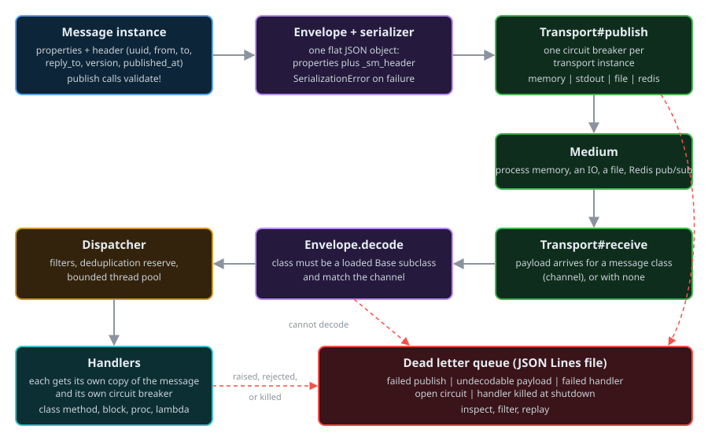

# Architecture

SmartMessage has four parts: message classes, an envelope codec with a serializer, transports, and a dispatcher. A message class knows what a message contains and who handles it. A transport knows how to move bytes. The envelope turns one into the other, and the dispatcher runs handlers.



## The parts

### Message classes

A message class inherits from `SmartMessage::Base` (a `Hashie::Dash`). It declares:

- properties, with defaults, validation and descriptions ([Properties and Validation](properties.md))
- default addressing: `from`, `to`, `reply_to` ([Addressing](addressing.md))
- a schema `version`
- its transport or transports, unless the global configuration supplies one ([Configuration](configuration.md))
- optionally, deduplication ([Message Deduplication](../reference/message-deduplication.md))
- a default handler, `def self.process(message)` ([Handlers](message-processing.md))

Each instance carries a header (`message._sm_header`, a `SmartMessage::Header`) with these fields:

| Field | Meaning |
|-------|---------|
| `uuid` | Unique id of this message instance; used for deduplication |
| `message_class` | Name of the message class |
| `published_at` | Set when the message is built and again when it is published |
| `publisher_pid` | Process id of the publisher |
| `version` | Schema version of the message class |
| `from`, `to`, `reply_to` | Addressing |
| `serializer` | Class name of the serializer that encoded it |
| `extensions` | Header fields this version does not define; kept so they survive a round trip |

### Envelope and serializer

`SmartMessage::Envelope` is the single codec every transport uses. On the wire a message is one flat structure: its properties plus a `_sm_header` entry. The serializer (`SmartMessage::Serializer::Json`) turns that structure into a String and back.

Decoding does not trust its input:

- the class named in the header must be a loaded subclass of `SmartMessage::Base`, otherwise `SmartMessage::Errors::UnknownMessageClass`
- when the payload arrived on a channel (the Redis transport has channels), the class named in the header must match that channel, otherwise `SmartMessage::Errors::MessageClassMismatch`
- only declared properties are passed to the message; anything else in the payload is dropped
- a payload that is not an envelope raises `SmartMessage::Errors::DecodeError`

A decoded message is not validated automatically. A handler that needs the guarantee calls `message.valid?` or `message.validate!`.

### Transports

A transport is a subclass of `SmartMessage::Transport::Base`. It publishes serialized messages and hands inbound payloads to its dispatcher. Each transport instance owns:

- a serializer
- a dispatcher (pass `dispatcher:` to share one between transports)
- a circuit breaker around publishing

Four transports ship with the gem: memory, stdout, file and Redis pub/sub. They have different delivery semantics; see [Transports](../reference/transports.md).

### Dispatcher

The dispatcher keeps the subscriptions of one transport. For each incoming message it finds the handlers subscribed to that message class, applies their filters, reserves the UUID when deduplication is on, and posts each handler to a bounded thread pool with its own copy of the message. See [Dispatcher](dispatcher.md).

## Publishing, step by step

`message.publish` does this:

1. `validate!`: raises `SmartMessage::Errors::ValidationError` if the message is invalid.
2. Raises `SmartMessage::Errors::TransportNotConfigured` if there is no transport.
3. Stamps `published_at` and `publisher_pid` in the header.
4. For each transport, independently: encode the message and call the transport inside its circuit breaker. A failure is recorded in the result and the message is written to the dead letter queue with that transport's name.
5. Returns a `SmartMessage::PublishResult`, or raises `SmartMessage::Errors::PublishError` if every transport failed.

## Receiving, step by step

When a transport receives a payload:

1. `Envelope.decode` rebuilds the message. A payload that cannot be decoded is stored in the dead letter queue.
2. The dispatcher looks up the subscriptions for the message class.
3. For each subscription whose [filters](message-filtering.md) match:
    1. if deduplication is enabled, the UUID is reserved in that handler's queue; a UUID that is already there is skipped
    2. the handler is posted to the thread pool with a copy of the message
4. On a pool thread, the handler runs inside its own circuit breaker.
5. If the handler raises, or its circuit is open, the deduplication reservation is released and the message goes to the dead letter queue. Other handlers are not affected.

## Failure handling at a glance

| What went wrong | What happens |
|-----------------|--------------|
| Message is invalid | `publish` raises `ValidationError`; nothing is sent |
| No transport | `publish` / `subscribe` raise `TransportNotConfigured` |
| One of several transports fails | The result is `partial?`; the message is dead-lettered for that transport |
| Every transport fails | `publish` raises `PublishError`; the message is dead-lettered once per transport |
| Payload cannot be decoded | Stored raw in the dead letter queue |
| Handler raises | Message dead-lettered with `transport: "handler:<handler id>"` |
| Handler circuit is open | Handler is not called; message dead-lettered |
| Handler still running at shutdown timeout | Handler is killed; message dead-lettered |

See [Dead Letter Queue](../reference/dead-letter-queue.md) and [Circuit Breakers](../reference/circuit-breakers.md).

## Statistics

`SmartMessage::Stats` is a thread-safe counter store. The framework counts `publish` per message class, and `routed`, `processed`, `failed` and `duplicate` per message class and handler.

```ruby
SmartMessage::Stats.get('OrderMessage', 'publish')                              # => 12
SmartMessage::Stats.get('OrderMessage', 'OrderMessage.process', 'processed')    # => 12
SmartMessage::Stats.stat    # every counter, keys joined with "+"
SmartMessage::Stats.reset   # clear all counters
```

## Extension gems

Transports for NATS, RabbitMQ, named pipes and lanet exist as separate `smart_message-transport-*` gems; they have not yet been updated for 0.1.0.
