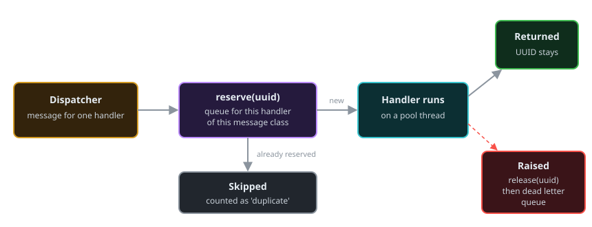

# Message Deduplication

Deduplication stops a handler from processing the same message twice. A message is identified by the UUID in its header. It is off by default and enabled per message class.

```ruby
# messages/order_message.rb
class OrderMessage < SmartMessage::Base
  from 'order-service'

  ddq_size 500           # optional; default 100
  ddq_storage :memory    # optional; :memory (default) or :redis
  enable_deduplication!

  property :order_id, required: true

  def self.process(message)
    Fulfillment.start(message.order_id)
  end
end
```

The settings are inherited by subclasses. `disable_deduplication!` turns it off for a class.

## How it works



- **One queue per handler per message class.** The deduplication queues (DDQs) belong to the dispatcher. `OrderMessage` handled by `OrderMessage.process` has one queue; the same message class handled by a second handler has another. A message that one handler has seen is still delivered to the others.
- **Reserve before the handler runs.** When a message is routed, the dispatcher atomically records its UUID in the handler's queue. If the UUID was already there, the handler is skipped and the `duplicate` counter is incremented. Because the reservation is made before the handler starts, a second copy that arrives while the first is still being processed is skipped too.
- **Release on failure.** If the handler raises, or its circuit breaker rejects the call, the reservation is released and the message goes to the [dead letter queue](dead-letter-queue.md). A redelivery or a replay of that message is then processed.
- **A successful handler keeps the reservation,** until it is evicted (memory) or expires (Redis).

You do not call anything from the handler. There is no API for marking a message as processed.

The queue is created when the handler subscribes, so a bad configuration (an unreachable Redis server, for instance) fails the `subscribe` call.

If the queue becomes unavailable later, the dispatcher logs an error and processes the message without deduplication rather than dropping it.

## Storage backends

### Memory

```ruby
ddq_size 1000
ddq_storage :memory
```

A circular buffer of the last `ddq_size` UUIDs with a Hash index, guarded by a Mutex. When it is full, the oldest UUID is evicted. It lives in one process: other processes, and the same process after a restart, know nothing about it.

| Setting | Default | Meaning |
|---------|---------|---------|
| `ddq_size` | `100` | UUIDs remembered per handler |

### Redis

```ruby
require 'redis'

ddq_storage :redis, redis: Redis.new(url: 'redis://localhost:6379'), ttl: 3600
```

Each UUID is one Redis key written with `SET NX EX`, which makes the reservation atomic across every process that shares the Redis server. Use it when several processes run the same handler and must not both process a message.

| Option | Default | Meaning |
|--------|---------|---------|
| `redis:` | `Redis.new` | A Redis client |
| `ttl:` | `3600` | Seconds a UUID is remembered |

Storage is bounded by time, not by count: `ddq_size` is accepted but does not limit the Redis backend.

Keys are named `smart_message:ddq:<MessageClass>:<handler id>:<uuid>`. Two processes share a record when they run the same named handler for the same message class. Block, proc and lambda handlers get a generated id per `subscribe` call, so they do not share a record across processes; use a named class method for handlers that must deduplicate across processes.

The Redis backend fails open. If Redis cannot be reached when the queue is created, `subscribe` raises `SmartMessage::Errors::TransportError`. If Redis fails later, the error is logged and the message is processed.

## Statistics and maintenance

```ruby
OrderMessage.ddq_enabled?   # => true
OrderMessage.ddq_config     # => { enabled: true, size: 500, storage: :memory, options: {} }

OrderMessage.ddq_stats
# => {
#   enabled: true,
#   queues: {
#     "OrderMessage:OrderMessage.process" => {
#       size: 500, storage_type: :memory, implementation: "SmartMessage::DDQ::Memory",
#       current_count: 2, utilization: 0.4, next_index: 2
#     }
#   }
# }

OrderMessage.clear_ddq!     # forget every UUID this class's handlers have seen

SmartMessage::Stats.get('OrderMessage', 'OrderMessage.process', 'duplicate')   # duplicates skipped
```

`ddq_stats` returns `{ enabled: false }` for a class without deduplication. `queues` has one entry per subscribed handler on each of the class's transports.

## When duplicates happen

- The same message instance is published twice (a retry in application code).
- A dead letter queue entry is replayed: the replayed message has the original UUID.
- A message class has two transports and a process subscribes on both.

For the last case the two transports must share the record: give them the same dispatcher (`dispatcher:` option), or use the Redis backend.

Each call to `MessageClass.new` creates a new UUID. Two messages with identical content are not duplicates.

## A complete program

```ruby
require 'smart_message'
require 'tmpdir'

SmartMessage.configure do |config|
  config.transport = SmartMessage::Transport::MemoryTransport.new
  config.dlq_path  = File.join(Dir.mktmpdir, 'dead_letters.jsonl')
end

# messages/charge_message.rb
class ChargeMessage < SmartMessage::Base
  from 'checkout'
  ddq_size 50
  enable_deduplication!

  property :amount, required: true
  property :fail_once

  @attempts = 0

  class << self
    attr_accessor :attempts

    def process(message)
      self.attempts += 1
      raise 'card processor timeout' if message.fail_once && attempts == 1

      puts "charged #{message.amount} (uuid #{message.uuid[0, 8]})"
    end
  end
end

def wait_for_handlers
  dispatcher = ChargeMessage.transport.dispatcher
  sleep 0.05 until dispatcher.status[:in_flight].zero?
end

ChargeMessage.subscribe

# 1. The same message published twice is handled once
charge = ChargeMessage.new(amount: 10)
charge.publish
charge.publish
wait_for_handlers

# 2. A failed handler releases its reservation, so the retry is processed
ChargeMessage.attempts = 0
retried = ChargeMessage.new(amount: 20, fail_once: true)
retried.publish
wait_for_handlers
retried.publish
wait_for_handlers

SmartMessage.shutdown

stats = ChargeMessage.ddq_stats[:queues]['ChargeMessage:ChargeMessage.process']
puts <<~REPORT
  duplicates skipped: #{SmartMessage::Stats.get('ChargeMessage', 'ChargeMessage.process', 'duplicate')}
  UUIDs remembered:   #{stats[:current_count]}
  dead letters:       #{SmartMessage::DeadLetterQueue.default.size}
REPORT
```

It charges 10 once and 20 once, reports one duplicate skipped, two UUIDs remembered, and one dead letter (the first, failed attempt at the second charge).

## Using a queue directly

```ruby
ddq = SmartMessage::DDQ.create(:memory, 100)

ddq.reserve('uuid-1')     # => true   recorded by this call
ddq.reserve('uuid-1')     # => false  already there
ddq.contains?('uuid-1')   # => true
ddq.release('uuid-1')     # forget it
ddq.stats
ddq.clear
```

A custom backend subclasses `SmartMessage::DDQ::Base` and implements `reserve`, `release`, `contains?`, `clear` and `storage_type`. `reserve` and `release` must be atomic.
