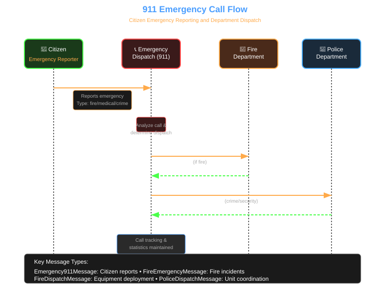
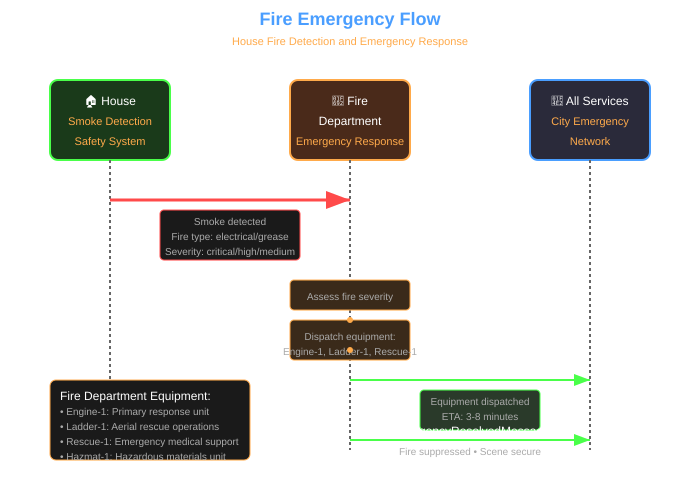
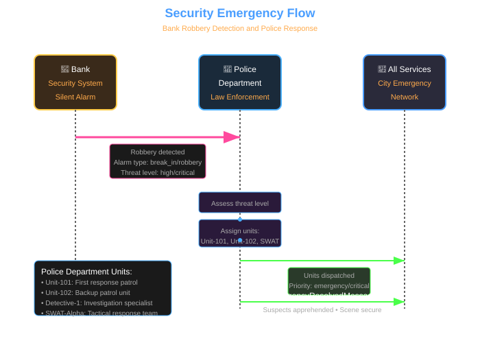
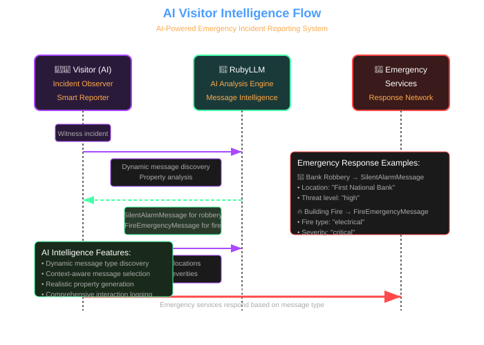
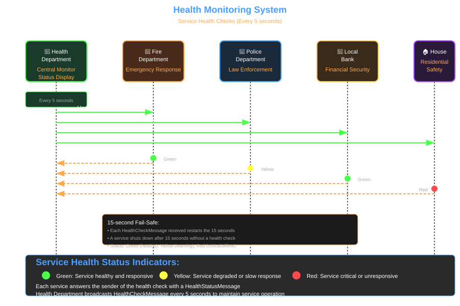
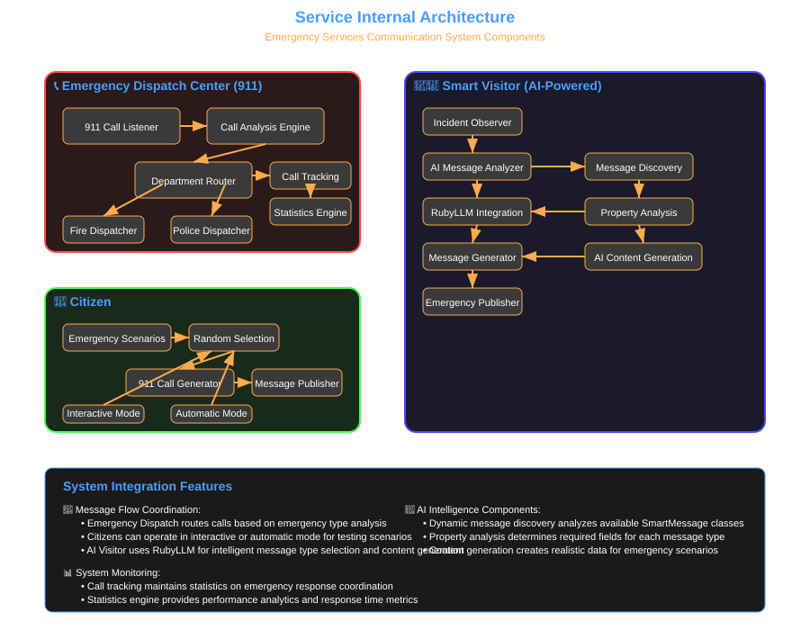

# SmartMessage City Emergency Services Demo

A city's emergency services as a set of independent programs that talk to each other through the SmartMessage Redis transport. Each program is its own process; they coordinate only by publishing and subscribing to messages.

It is long-running and multi-process, so `examples/run_all.rb` does not run it. `smoke_test.rb` checks it in a few seconds.

## Programs

| Program | Address (`from`) | What it does |
|---------|------------------|--------------|
| `health_department.rb` | `health-department` | Broadcasts a health check every 5 seconds, shows each service's status and every resolved incident |
| `emergency_dispatch_center.rb` | `emergency-dispatch-center`, receives calls sent to `911` | Routes each 911 call to the fire department, the police department, or both |
| `police_department.rb` | `police_department` | Answers silent alarms and 911 calls, assigns units, reports resolved incidents |
| `fire_department.rb` | `fire_department` | Answers fire emergencies and 911 calls, assigns engines, reports resolved incidents |
| `local_bank.rb` | `first-national-bank` | Occasionally sends a silent alarm to the police |
| `house.rb [address]` | `house-<address>` | Occasionally reports a fire to the fire department |
| `citizen.rb [auto]` | `citizen-<name>` | Calls 911, on Enter or automatically |
| `visitor.rb [seconds \| --once]` | `visitor` | Reports observations; chooses the message class itself (see below) |
| `redis_monitor.rb` | | Shows every message on the city's channels as it is published |
| `redis_stats.rb` | | Terminal dashboard of the Redis server's pub/sub statistics |
| `smoke_test.rb` | | Publishes and receives one sample of every message class |

Supporting files:

- `messages/` holds the eight message classes.
- `common/city.rb` configures SmartMessage for a process: transport, namespace, log file, dead letter queue.
- `common/service.rb` gives a program its name, logger, lock and main loop.
- `common/health_monitor.rb` answers health checks and stops a service that no longer receives them.
- `smart_message_ai_agent.rb` is the base class of the visitor.

## Message types

| Message | Publisher | Receiver | Addressing |
|---------|-----------|----------|------------|
| `Emergency911Message` | citizen, visitor | dispatch center | `to: '911'` |
| `Emergency911Message` (forwarded) | dispatch center | police or fire | `to:` the department |
| `FireEmergencyMessage` | house, dispatch center | fire department | `to: 'fire_department'` |
| `FireDispatchMessage` | fire department | whoever reported the fire | `to:` the sender of the emergency |
| `SilentAlarmMessage` | bank | police department | `to: 'police_department'` |
| `PoliceDispatchMessage` | police department | the bank | `to:` the sender of the alarm |
| `EmergencyResolvedMessage` | police, fire | health department | broadcast |
| `HealthCheckMessage` | health department | every service | broadcast |
| `HealthStatusMessage` | every service | health department | `to:` the sender of the health check |

Every message class lives in `messages/` and has no transport of its own. `common/city.rb` sets one Redis transport for all of them:

```ruby
SmartMessage.configure do |config|
  config.logger    = SmartMessage::Logger::Default.new(log_file: log_file(program_name), level: :info)
  config.dlq_path  = File.join(log_dir, 'dead_letters.jsonl')
  config.transport ||= SmartMessage::Transport::RedisTransport.new(url: redis_url, namespace: namespace)
end
```

A service subscribes with a block and an address filter, and replies to the sender:

```ruby
Messages::SilentAlarmMessage.subscribe(to: 'police_department') { |alarm| handle_silent_alarm(alarm) }

Messages::PoliceDispatchMessage.new(dispatch_id: id, units_assigned: units, ..., from: 'police_department', to: alarm.from).publish
```

## Message flow diagrams

### 911 emergency call



### Fire emergency



### Security emergency



### Visitor reporting



### Health monitoring



### Service internals



## Running

### Prerequisites

- Ruby 4.0 or newer and `bundle install` in the repository root
- A Redis server on `redis://localhost:6379` (or set `CITY_REDIS_URL`)
- For `start_demo.sh` and `stop_demo.sh`: macOS with iTerm2

### Smoke test

```bash
bundle exec ruby -Ilib examples/city_scenario/smoke_test.rb
```

It loads every file in `messages/`, then builds, validates, publishes and receives one sample of each message class over Redis, in its own namespace. It exits non-zero when anything fails.

### All programs in iTerm2 (macOS)

```bash
cd examples/city_scenario
./start_demo.sh     # one tab per program
./stop_demo.sh      # stops the programs and closes the window
```

### By hand

Start each program in its own terminal, from the repository root. Start the health department early: a service that receives no health check for 15 seconds shuts itself down.

```bash
bundle exec ruby -Ilib examples/city_scenario/health_department.rb
bundle exec ruby -Ilib examples/city_scenario/emergency_dispatch_center.rb
bundle exec ruby -Ilib examples/city_scenario/fire_department.rb
bundle exec ruby -Ilib examples/city_scenario/police_department.rb
bundle exec ruby -Ilib examples/city_scenario/local_bank.rb
bundle exec ruby -Ilib examples/city_scenario/house.rb '456 Oak Street'
bundle exec ruby -Ilib examples/city_scenario/citizen.rb auto
bundle exec ruby -Ilib examples/city_scenario/visitor.rb
bundle exec ruby -Ilib examples/city_scenario/redis_monitor.rb
bundle exec ruby -Ilib examples/city_scenario/redis_stats.rb
```

Stop a program with Ctrl+C.

Redis pub/sub delivers a message only to the programs that are subscribed at that moment. A 911 call made while the dispatch center is not running is lost; nothing queues it.

## Configuration

| Variable | Default | Meaning |
|----------|---------|---------|
| `CITY_REDIS_URL` | `$SMART_MESSAGE_TEST_REDIS_URL`, else `redis://localhost:6379` | Redis server |
| `CITY_NAMESPACE` | `city_scenario` | Redis channel prefix. Every program of one city must use the same value. Two cities on one server need different values, because pub/sub channels are global to a Redis server |
| `CITY_LOG_DIR` | `<system temp dir>/smart_message_city_scenario` | Log files and the dead letter queue |
| `CITY_HEALTH_CHECK_RATE` | `5` | Seconds between health checks |
| `CITY_ALARM_CHANCE` | `8` | Percent chance that a bank activity is a silent alarm |
| `CITY_FIRE_CHANCE` | `6` | Percent chance that a house activity is a fire |
| `CITY_CALL_INTERVAL` | random 15-30 | Seconds between a citizen's automatic calls |

To see a lot happen quickly:

```bash
CITY_ALARM_CHANCE=100 bundle exec ruby -Ilib examples/city_scenario/local_bank.rb
CITY_FIRE_CHANCE=100  bundle exec ruby -Ilib examples/city_scenario/house.rb
CITY_CALL_INTERVAL=3  bundle exec ruby -Ilib examples/city_scenario/citizen.rb auto
```

## Logs and dead letters

Nothing is written into the repository. Each program logs to `$CITY_LOG_DIR/<address>.log` (for example `police_department.log`, `house-456-oak-street.log`), and SmartMessage's own log lines go to the same file. The health department prints its log file's path when it starts.

A message whose handler raised, or that could not be published, is stored in `$CITY_LOG_DIR/dead_letters.jsonl`:

```ruby
SmartMessage::DeadLetterQueue.default.statistics
SmartMessage::DeadLetterQueue.default.inspect_messages(limit: 5)
```

## Health monitoring

1. The health department broadcasts a `HealthCheckMessage` every 5 seconds.
2. Each service answers the sender with a `HealthStatusMessage`: `healthy`, `warning`, `critical` or `failed`, plus a line of detail.
3. The health department prints the answers in green, yellow, orange and red.
4. A service that has received no health check for 15 seconds (`Common::HealthMonitor::FAIL_SAFE`) prints a warning and exits with status 1.

## The visitor

`visitor.rb` does not know in advance which message to send. `SmartMessageAIAgent` reads the description of each allowed message class, chooses one for the observation, reads the property descriptions and validation rules, and fills the message in.

- With the `ruby_llm` gem installed and a provider key in the environment (`ANTHROPIC_API_KEY`, `OPENAI_API_KEY`, `GEMINI_API_KEY`, or `OLLAMA_API_BASE`), a language model makes both choices. A message that fails validation is built again, with the validation errors given back to the model, up to three times.
- Otherwise the visitor uses its fallback rules: an `Emergency911Message` built from the observation.

`ruby_llm` is not a dependency of smart_message, so `bundle exec` does not load it. To use a model, install the gem and run the visitor without `bundle exec`, or add `ruby_llm` to your own Gemfile.

## Monitoring tools

`redis_monitor.rb` subscribes to `<namespace>:*` with its own Redis connection and prints each message: class, sender, receiver and the main properties. On the wire a message is one JSON object: its properties, plus its header under `_sm_header`.

```json
{
  "_sm_header": {
    "uuid": "0ab7367a-9d82-4e8e-8416-07de3111ff30",
    "message_class": "Messages::FireEmergencyMessage",
    "published_at": "2026-11-11T22:00:03.195000-06:00",
    "publisher_pid": 12345,
    "version": 1,
    "from": "house-456-oak-street",
    "to": "fire_department",
    "serializer": "SmartMessage::Serializer::Json"
  },
  "house_address": "456 Oak Street",
  "fire_type": "electrical",
  "severity": "medium",
  "timestamp": "2026-11-11 22:00:03",
  "occupants_status": "evacuated",
  "spread_risk": "medium"
}
```

`redis_stats.rb` is a full-screen dashboard of the Redis server: pub/sub channels and subscribers, command rates, latency, network traffic and connections. Keys: `q` quit, `r` refresh, `+`/`-` refresh rate, `h` help.

## Adding to the city

A new service:

1. `include Common::Service` (and `Common::HealthMonitor` if it should answer health checks, which needs a `get_status_details` method returning `[status, details]`).
2. Call `setup_service('its-address')`, subscribe with `to:` its address, and call `setup_health_monitor`.
3. Run its main loop with `run_service(interval) { ... }` and end with `shutdown_service`.

Handlers run on the dispatcher's thread pool while the main loop runs on the main thread. Change shared state inside `synchronize { ... }` (the `handling` helper does this for a handler).

A new message type:

1. Add the class to `messages/`, in the `Messages` module, with a `description` for the class and for each property.
2. Add a sample of it to `SAMPLES` in `smoke_test.rb`.
3. Subscribe to it in the services that should receive it.

## Troubleshooting

- **A service exits after 15 seconds**: the health department is not running, or runs with another `CITY_NAMESPACE`.
- **Nothing arrives**: check that every program uses the same `CITY_NAMESPACE` and Redis server, and watch `redis_monitor.rb`.
- **`No Redis server answered`**: start Redis or set `CITY_REDIS_URL`.
- **A handler fails**: the error is printed and logged, and the message is in `dead_letters.jsonl`.

## See also

- [Redis transport examples](../redis/README.md)
- [Redis transport documentation](../../docs/transports/redis-transport.md)
