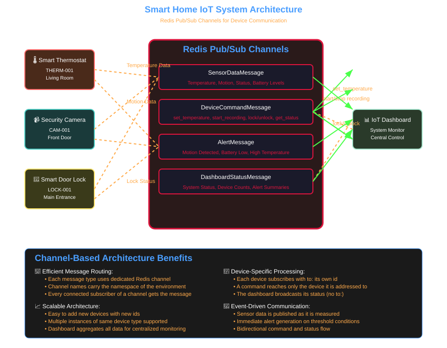
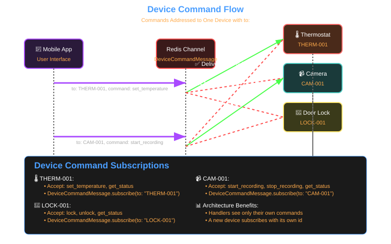
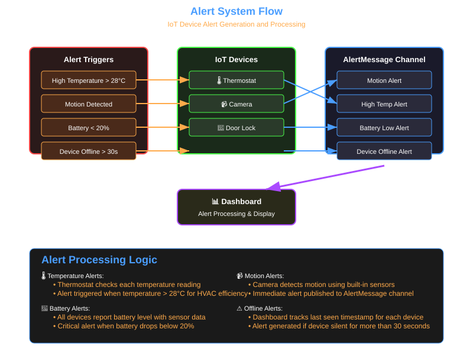
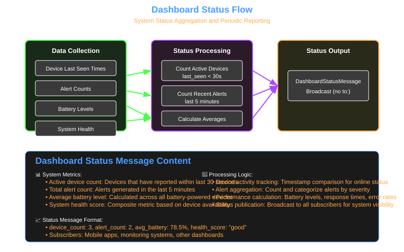

# Smart Home IoT Data Flow - Redis Pub/Sub Transport

The message flows of `01_smart_home_iot_demo.rb`: three devices, a dashboard and an app that communicate through Redis pub/sub channels.

The diagrams show the design. The script runs one deterministic pass through it (a reading from each device, three alerts, one command per device, one status broadcast) and checks each result.

## System Architecture Overview

Each message class has its own Redis channel. The channel name is the class name, prefixed with the transport's namespace (`sm_example_<random>:SensorDataMessage` in the example).



## Message Flow Details

### 1. Sensor Data Flow

Every device publishes its readings as `SensorDataMessage`, with its own id as `from`. The dashboard subscribes to all of them.

```ruby
SensorDataMessage.new(
  device_id: 'THERM-001', device_type: 'thermostat', location: 'living_room',
  sensor_type: 'temperature', value: 29.5, unit: 'celsius', battery_level: 90,
  from: 'THERM-001'
).publish
```

### 2. Device Command Flow

A command is addressed to one device with `to:`. Every device is subscribed to the `DeviceCommandMessage` channel, and the dispatcher hands a command only to the handler whose `to:` filter matches.



```ruby
# the device
DeviceCommandMessage.subscribe(to: 'THERM-001') { |command| handle_command(command) }

# the app
DeviceCommandMessage.new(
  command: 'set_temperature', parameters: { target: 22.0 },
  from: 'mobile-app', to: 'THERM-001'
).publish
```

### 3. Alert System Flow

Devices publish an `AlertMessage` when a reading crosses a threshold. The example raises a high temperature alert, a motion alert and a low battery alert. The offline alert in the diagram is not part of the script.



### 4. Dashboard Status Flow

The dashboard counts the devices and alerts it has seen and broadcasts a `DashboardStatusMessage` (no `to:`). The app subscribes with `broadcast: true, from: 'dashboard'`.



## Channels

| Message class | Publishers | Subscribers | Purpose |
|---------------|------------|-------------|---------|
| `SensorDataMessage` | devices | dashboard | sensor readings |
| `DeviceCommandMessage` | app | devices (`to:` own id) | device control |
| `AlertMessage` | devices | dashboard | notifications |
| `DashboardStatusMessage` | dashboard | app (`broadcast: true`) | system summary |

## What Redis pub/sub does and does not do

- Every subscriber connected to a channel receives each message published on it. There is no load balancing between subscribers.
- Nothing is stored. A subscriber that is not connected when a message is published never sees it.
- Channels are global to the Redis server. The namespace, not the `db` number, separates environments.

## Running the Example

```bash
bundle exec ruby -Ilib examples/redis/01_smart_home_iot_demo.rb
```

## Watching the Channels

The namespace of a run is printed in step 1.

```bash
redis-cli PUBSUB CHANNELS 'sm_example_*'
redis-cli PSUBSCRIBE 'sm_example_*'
```
